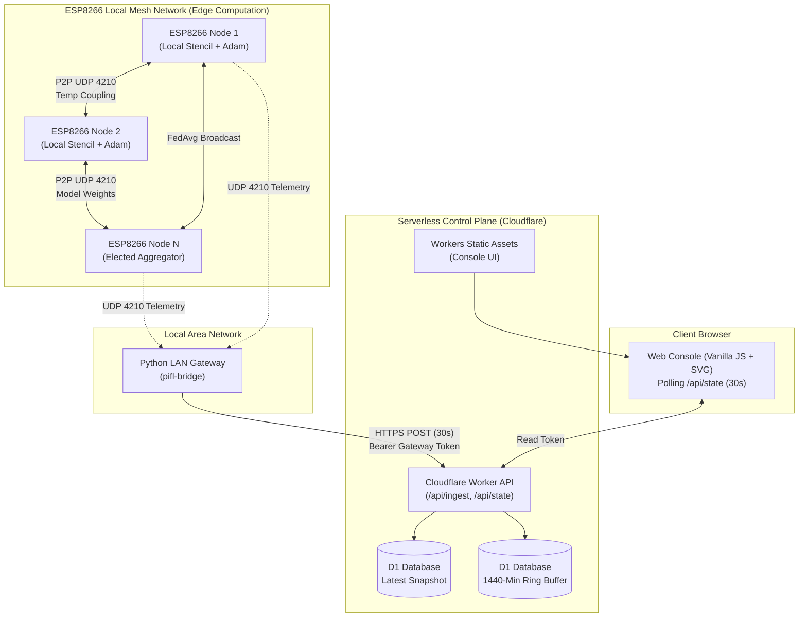

# Physics-Informed Federated Learning on ESP8266

Physics-informed federated learning (PIFL) on resource-constrained ESP8266 microcontrollers, coupled with a serverless Cloudflare telemetry control plane, an interactive browser console, and an automated CI/CD pipeline.

---

## Architecture Overview

PIFL implements distributed thermal modeling directly at the IoT edge. Physical ESP8266 nodes simulate a 2D heat-diffusion partial differential equation (PDE) over a finite-difference spatial stencil, augment the physics with a local neural/polynomial correction model, and collaboratively refine weights using peer-to-peer federated averaging (FedAvg).

A lightweight local area network (LAN) telemetry bridge collects UDP broadcasts and pushes authenticated periodic snapshots to a serverless Cloudflare Workers + D1 backend, rendered in a zero-dependency web console.



---

## Core Capabilities

- **On-Device Physical-Neural Modeling**:
  - Solves the 2D heat equation $\frac{\partial T}{\partial t} = \alpha \nabla^2 T + f(T)$ via explicit Euler time stepping on a 4-neighbor stencil.
  - Zero-flux Neumann boundary masking when physical neighbors are absent.
  - Learnable quadratic polynomial correction $f(\hat{T}) = w_1 \hat{T} + w_2 \hat{T}^2 + b$ using feature standardization $\hat{T} = \frac{T - 25.0}{10.0}$.
  - On-device Adam optimizer update with gradient sensitivity tracking and parameter clamping.
- **Decentralized Multi-Device Federated Learning**:
  - Peer-to-peer UDP broadcasts for discovery, temperature coupling, and model distribution.
  - Dynamic aggregator election electing the lowest active node ID.
  - Sample-weighted Federated Averaging (FedAvg) with rollover-safe round indexing.
  - Session boot IDs to reject stale updates from reboots or split-brain partitions.
- **Protocol v2 Wire Framing**:
  - Compact binary payloads with a 3-byte header and a 4-byte FNV-1a integrity checksum envelope.
- **Cloudflare Telemetry Control Plane**:
  - Zero external NPM dependencies: native browser ES modules and scalable SVG charts.
  - Workers + D1 database storing atomic snapshots and a bounded 24-hour circular history ring.
  - Role-based token separation (Gateway Write Token vs Client Read Token).
  - Built-in simulation mode for offline exploration.
- **Verification & CI/CD**:
  - 575 native C++ regression checks, cross-language packet codecs (C++, Python, JS).
  - Frozen-holdout thermal benchmark comparing against physics-only and centralized baselines.
  - Automated GitHub Actions testing, firmware artifact compilation, and Cloudflare deployment with smoke checks and rollback.

---

## Project Layout

```
FL-on-ESP2866/
├── include/                 # Firmware headers (C++17)
│   ├── config.h             # Topology, timing, network secret, and hyperparameters
│   ├── discretization.h     # 2D finite-difference Laplacian & Euler time stepping
│   ├── node_model.h         # Phase 2 polynomial model, feature scaling, & Adam
│   ├── node_state.h         # Neighbor stencil, FedAvg aggregation, & election
│   ├── packet_envelope.h    # Framing envelope and FNV-1a checksum codec
│   ├── pifl_types.h         # Fixed-size structs, enums, and peer states
│   ├── protocol.h           # Protocol v2 binary packet codec
│   ├── sensor.h             # Synthetic, analog, & DS18B20 OneWire drivers
│   └── transport.h          # UDP broadcast abstraction
├── src/                     # Firmware implementations (C++17)
│   ├── discretization.cpp
│   ├── main.cpp             # Arduino/ESP8266 main loop
│   ├── node_model.cpp
│   ├── node_state.cpp
│   ├── packet_envelope.cpp
│   ├── protocol.cpp
│   ├── sensor.cpp
│   └── transport.cpp
├── cloud/                   # Cloudflare Workers control plane
│   ├── migrations/          # D1 SQL numbered migrations (0001_initial.sql)
│   ├── repository.mjs       # Transactional D1 database queries & ring buffer
│   └── worker.mjs           # HTTP API router, auth, & static asset delivery
├── console/                 # Browser monitoring console (Zero-dependency ES modules)
│   ├── index.html           # Responsive layout & SVG charts
│   ├── app.mjs              # Application routing & polling lifecycle
│   ├── data/                # API client & offline simulation generator
│   ├── state/               # Reactive client store
│   └── ui/                  # Component rendering & metric formatting
├── shared/                  # Universal domain logic
│   └── domain.mjs           # Validation, freshness, metric calculations, & telemetry guide
├── pifl_vis/                # Python visualization & telemetry bridge
│   ├── bridge.py            # Bounded LAN UDP-to-HTTPS telemetry gateway
│   ├── protocol.py          # Python Protocol v2 wire codec
│   └── server.py            # Local HTTP/WebSocket live telemetry server
├── dashboard/               # Legacy Node.js dashboard backend & UI
├── experiments/             # Benchmarks & scientific validation
│   ├── run_benchmark.py     # Thermal holdout experiment runner
│   └── thermal_benchmark.cpp# High-performance C++ benchmark simulation
├── ppt/                     # Slide deck generation
│   └── generator.py         # Pure-Python PowerPoint overview builder
├── scripts/                 # Build, test, deployment, & smoke test tooling
│   ├── build.mjs            # Production bundle packager
│   ├── check.mjs            # JavaScript syntax & ES module validation
│   ├── deploy.mjs           # Cloudflare deployment automation
│   ├── dev.mjs              # Local development server for console
│   └── smoke.mjs            # Production health & API smoke verification
├── tests/                   # Test suite
│   ├── cloud/               # Node.js tests for Workers, D1 SQL, & domain logic
│   ├── native_core.cpp      # C++ native regression test suite
│   ├── test_native_core.py  # Python harness for native C++ tests
│   ├── test_bridge.py       # Telemetry bridge unit tests
│   └── test_simulation_run.py # End-to-end integration simulation
├── docs/                    # Technical documentation
│   ├── architecture.md      # System boundaries, data structures, & budget
│   └── deployment.md        # Deployment guide, secrets setup, & rollback
├── platformio.ini           # PlatformIO build configuration (nodemcuv2)
└── pyproject.toml           # Python packaging configuration
```

---

## Quick Start

### 1. Interactive Web Console (Local Preview)

Preview the web console locally without cloud services:

```bash
npm ci --ignore-scripts
npm run dev
```

Open [http://127.0.0.1:3000](http://127.0.0.1:3000) and click **Explore simulation** to test the UI, inspect simulated nodes, and view real-time SVG charts.

### 2. LAN Telemetry Gateway Bridge

Run the bridge on a LAN machine (laptop, Raspberry Pi) to forward ESP8266 UDP broadcasts to the Cloudflare control plane over HTTPS:

```bash
export PIFL_GATEWAY_ID="lab-01"
export PIFL_GATEWAY_TOKEN="<your-32-char-gateway-token>"
export PIFL_CLOUD_URL="https://fl-on-esp2866.<your-subdomain>.workers.dev"

python3 -m pifl_vis.bridge \
  --gateway-id "$PIFL_GATEWAY_ID" \
  --endpoint "$PIFL_CLOUD_URL/api/ingest" \
  --udp-port 4210 \
  --interval 30
```

### 3. Local Python Telemetry Dashboard (Direct LAN)

For local direct monitoring without cloud services:

```bash
python3 -m pifl_vis.server --http-port 8080 --udp-port 4210
```

Open [http://127.0.0.1:8080](http://127.0.0.1:8080).

### 4. Firmware Flashing (ESP8266)

Configure [`include/config.h`](include/config.h) before flashing:
- `kWifiSsid` / `kWifiPassword`: WiFi credentials.
- `kNodeId`: Set to `0` for auto-derived chip IDs, or assign `1..12` manually.
- `kAggregatorNodeId`: Set to `0` for automatic lowest-ID leader election.
- `kSensorMode`: Set to `SensorMode::Synthetic` for dry runs, or `SensorMode::AnalogLinear` / `SensorMode::Ds18b20OneWire` for hardware.

Compile and upload with PlatformIO:

```bash
pio run -e nodemcuv2 -t upload
pio device monitor -b 115200
```

---

## Wire Protocol v2 Specification

All datagrams are framed with a 3-byte header and a 4-byte FNV-1a integrity checksum envelope:

```text
| NodeID (1B) | Type (1B) | Version (1B) | Payload (variable) | FNV Checksum (4B) |
```

### Packet Types & Encodings

| Type ID | Packet Name | Payload Fields | Payload Size | Total Wire Size |
| :---: | :--- | :--- | :---: | :---: |
| `0x01` | **Temperature** | `floatLE temperatureC` | 7 B | **11 B** |
| `0x02` | **ModelUpdate** | `floatLE w1, w2, b`, `uint32LE sampleCount`, `uint16LE round`, `floatLE meanLocalLoss`, `uint16LE baseRound`, `uint8_t baseLeaderId`, `uint32LE baseLeaderBootId, senderBootId` | 36 B | **40 B** |
| `0x03` | **GlobalAggregation** | `floatLE w1, w2, b`, `uint16LE round`, `floatLE meanContributorLoss`, `uint32LE leaderBootId` | 25 B | **29 B** |
| `0x04` | **Discovery** | `uint8_t roleFlags`, `uint32LE bootId` | 8 B | **12 B** |

- **Rollover-Safe Round Numbering**: Compares round IDs using modulo arithmetic: `0 < ((candidate - previous) & 0xFFFF) < 0x8000`.
- **Integrity Envelope**: FNV-1a checksum computed across the payload and the pre-shared network key (`PIFL_NETWORK_SECRET`).

---

## Mathematical & Learning Formulation

### 1. Spatial Discretization (Phase 1)
The 2D continuous diffusion PDE is discretized on a 5-point Cartesian stencil:
$$\nabla^2 T_{i,j} \approx \frac{T_{i+1,j} + T_{i-1,j} + T_{i,j+1} + T_{i,j-1} - 4T_{i,j}}{\Delta x^2}$$
If any neighbor is offline or unassigned, a **zero-flux Neumann boundary condition** ($\frac{\partial T}{\partial n} = 0$) is enforced by masking missing neighbors to the local center temperature.

### 2. Neural Correction & Prediction (Phase 2)
The physics prediction is augmented by a learnable quadratic polynomial:
$$\hat{T}_{t} = \frac{T_{t} - 25.0}{10.0}$$
$$T_{t+1}^{\text{pred}} = T_{t} + \Delta t \left( \alpha \nabla^2 T_{t} \right) + \left( w_1 \hat{T}_{t} + w_2 \hat{T}_{t}^2 + b \right)$$

### 3. On-Device Optimization
Prediction error $\delta = T_{t+1}^{\text{measured}} - T_{t+1}^{\text{pred}}$ yields sensitivities:
$$\frac{\partial \mathcal{L}}{\partial w_1} = -\delta \hat{T}_{t}, \quad \frac{\partial \mathcal{L}}{\partial w_2} = -\delta \hat{T}_{t}^2, \quad \frac{\partial \mathcal{L}}{\partial b} = -\delta$$
Gradients update weights on-device via the **Adam optimizer** with first ($m$) and second ($v$) moment estimates, bias correction, and parameter clamping.

### 4. Federated Aggregation (FedAvg)
The elected aggregator node computes a sample-weighted average across all participating peers:
$$w_{\text{global}} = \frac{\sum_{k} n_k w_k}{\sum_{k} n_k}$$

---

## Testing & Benchmarks

### 1. Python & Native C++ Test Suite
Executes 575 native C++ regression checks, cross-language packet validation, bridge tests, and simulation runs:

```bash
python3 -m unittest discover tests -v
```

### 2. Cloud Domain & Worker Tests
Validates Cloudflare Worker routes, transactional D1 SQL queries, circular history ring operations, and schema guards:

```bash
npm test
npm run check
```

### 3. Thermal Holdout Numerical Benchmark
Evaluates predictive performance against persistence, pure-physics, local-only, and centralized benchmarks:

```bash
python3 experiments/run_benchmark.py
```

*Benchmark Output Example:*
```json
{
  "scenario": "synthetic_3x3_insulated_plate",
  "scores": {
    "persistence":   { "rmse_c": 0.01998, "mae_c": 0.01998 },
    "physics_only":  { "rmse_c": 0.01998, "mae_c": 0.01998 },
    "local_only":    { "rmse_c": 0.01223, "mae_c": 0.01086 },
    "federated":     { "rmse_c": 0.00541, "mae_c": 0.00466 },
    "centralized":   { "rmse_c": 0.00153, "mae_c": 0.00132 }
  }
}
```

### 4. PowerPoint Slide Deck Generator
Generates a complete technical presentation deck as an artifact:

```bash
python3 -m ppt.generator --output artifacts/pifl_overview.pptx
```

---

## Deployment & CI/CD Pipeline

The repository includes a production-grade CI/CD pipeline ([`.github/workflows/ci-cd.yml`](.github/workflows/ci-cd.yml)):

1. **Native & Python Regressions**: Runs native C++ tests under `g++` with address/undefined sanitizers (`PIFL_SANITIZE=1`).
2. **Firmware Compilation**: Builds firmware with pinned dependencies (`platformio==6.1.18`, `espressif8266@4.2.1`) and uploads `.bin`/`.elf` artifacts.
3. **Console & Cloud Verification**: Syntax checks ES modules, validates D1 migrations, executes domain tests, and packages release bundles.
4. **Automated Cloudflare Release**: When configured, deploys assets and worker API using `npm run deploy`, followed by `npm run smoke` validation.
5. **Instant Rollback**: Dedicated automated rollback workflow ([`.github/workflows/rollback.yml`](.github/workflows/rollback.yml)) restores previous stable deployments in the event of failure.

For detailed configuration instructions and secrets management, consult:
- [**Control Plane Architecture & Free-Tier Budget**](docs/architecture.md)
- [**Deployment & Telemetry Bridge Setup**](docs/deployment.md)

---

## License

MIT License.
