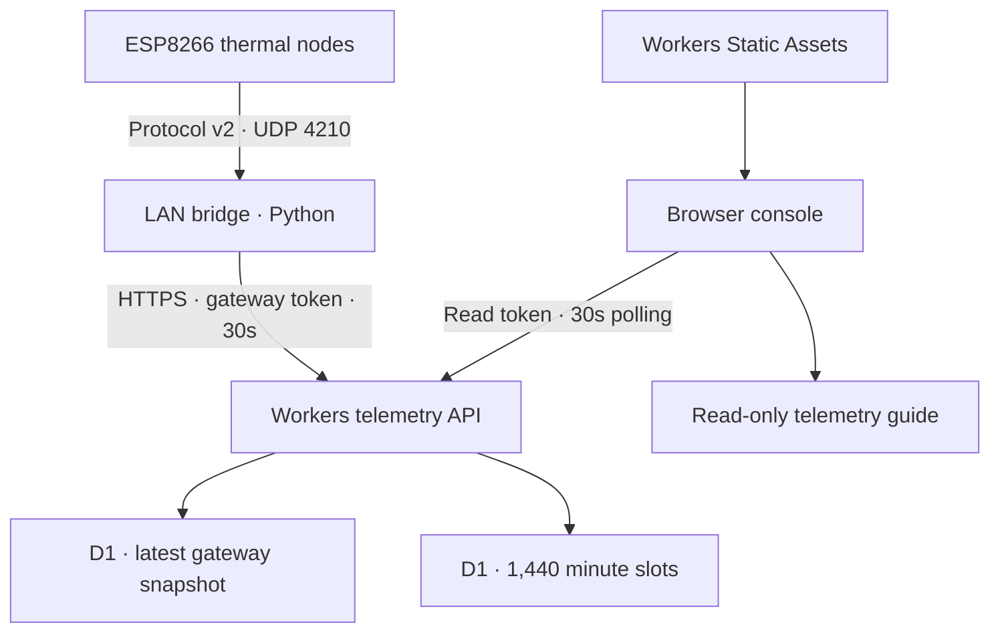

# PIFL control plane: architecture and data contracts

The ESP8266 network remains the computation plane. A LAN gateway validates protocol-v2 broadcasts and uploads compact observations to a Cloudflare Worker. The browser renders those observations; it never performs aggregation or controls firmware. The initial cloud installation supports **one gateway and up to 12 boards**, matching the firmware peer budget.

## System boundary

The bridge is necessary: Workers do not bind a LAN UDP broadcast socket. It runs on an existing laptop, Raspberry Pi, or LAN host. It requires outbound HTTPS only. Internet loss does not stop local firmware training or peer aggregation. A functioning cloud dashboard requires that LAN host to remain online.

## Separation of responsibilities

| Layer | Files | Responsibility |
| --- | --- | --- |
| Firmware | `src/`, `include/` | Sensors, finite differences, Adam, leader election, sample-weighted FedAvg |
| Wire codec | `pifl_vis/protocol.py` | Existing v2 decoding, lengths, ranges, FNV integrity envelope |
| LAN adapter | `pifl_vis/bridge.py` | Bounded admission, sender boot verification, latest observations, HTTPS delivery |
| Domain | `shared/domain.mjs` | Schema validation, freshness, summaries, metric interpretation, guide responses |
| Persistence | `cloud/repository.mjs` | Transactional D1 updates and history-ring access |
| HTTP adapter | `cloud/worker.mjs` | Authentication, bounded body reading, status codes, repository calls |
| Browser data adapter | `console/data/client.mjs` | Authenticated API reads and request errors |
| Browser state | `console/state/store.mjs` | Filters, selections, bounded history, presentation mode |
| Presentation | `console/ui/`, `console/style.css`, `console/index.html` | Charts, membership view, tables, responsive layout, dialogs |
| Interaction wiring | `console/app.mjs` | Routes, polling lifecycle, export, token entry, interaction events |
| Release integration | `scripts/`, `.github/workflows/` | Reproducible packaging, deployment, smoke checks, rollback |

The root Node package has **zero third-party dependencies**. Browsers use native ES modules and SVG. Firmware and the legacy local dashboard retain their own dependency scopes. The earlier Python and Node dashboards remain available as legacy local tools.

## Why these data structures

| Structure | Key / bound | Cost and reason |
| --- | --- | --- |
| Gateway node dictionary | `node_id`, maximum 12 | O(1) lookup; IDs are uint8. Unknown nodes are rejected once the bound is reached. Restart or reconfigure the bridge to replace an admitted fleet. |
| Boot identity | `(gateway_id, node_id, boot_id)` | A node ID identifies a board address within one lab, not a globally unique device. Boot IDs separate training sessions and prevent accepting models from an old boot. |
| Latest cloud row | `gateway_id` primary key | O(1) indexed lookup. One atomic gateway snapshot avoids 12 individual writes per upload and gives a consistent capture boundary. |
| History ring | `(gateway_id, minute % 1440)` primary key | Fixed storage. First accepted observation per minute. New days overwrite old slots; no deletion jobs or unbounded event log. |
| Browser history array | Maximum 1,440 minute points | Chronological plotting and export; same-minute observations replace each other. Small enough to avoid a linked structure or indexing framework. |
| Packet counters | Five fixed fields | Constant space. Not an audit log; counters reset on bridge restart. |

Cloud history contains compact **network summaries**, not per-node raw packet histories. The latest snapshot includes per-node observations. A future requirement for retrospective per-node analysis would need a separate bounded per-node series and a revised write/read budget.

Fixed snapshots deliberately trade high-frequency cloud fidelity for a small, predictable free-tier footprint. The legacy LAN dashboard remains useful for packet-rate inspection. A persistent WebSocket/DO service adds coordination and connection lifecycle complexity without a requirement for subsecond cloud updates; it is unnecessary at this scale.

## Snapshot contract and time

`schemaVersion: 1` snapshots carry `gatewayId`, a UUID `sessionId`, UTC epoch-ms `capturedAt`, normalized nodes, an optional aggregate, and packet counters. Each node includes independent `seenAt`, `temperatureAt`, and `modelAt` timestamps. Labels are at most 48 characters; a snapshot is at most 32 KiB.

The bridge translates monotonic observation ages to epoch timestamps at capture. The Worker accepts captures from 120 seconds in the past to 30 seconds in the future. Keep the gateway clock synchronized. Offline backlogs are not replayed: after a failure, the next upload reflects the latest state.

Latest-row updates compare capture timestamps. A capture that is older than or equal to the stored capture cannot overwrite it or refresh the gateway receipt time. History writes share the same D1 batch transaction and run only when the exact capture occupies the latest row. A gateway restart uses a new session UUID and current wall-clock timestamps; it does not require a persisted sequence counter. Two gateway processes must not share an identity: the contract intentionally has a single writer per gateway.

Node online state is measured **at capture**, with a 6-second window. Models and aggregates use a 15-second freshness window. The cloud marks a gateway stale after 90 seconds without a newly accepted capture. A new heartbeat never makes an old temperature or model sample fresh. Between uploads the UI displays capture age, rather than inventing current device observations. Node inspection retains aged values with their sample ages for debugging.

The history SQL uses the primary-key prefix to bound scans to 1,440 rows. A second timestamp index would reduce short-window scans but add write amplification for every overwritten slot. At the initial scale, a short bounded scan every five minutes is the simpler choice. Revisit with actual D1 row-read metrics if the viewer count grows.

## Authentication and threat boundary

The static shell is public. State and history require a read token; ingestion requires a separate gateway token. The deployment requires two distinct, randomly generated tokens of 32+ characters. The Worker binds those as secrets, never public variables. Read tokens stay in browser session storage; they are excluded from URLs and JSON exports. The bridge refuses redirects so it cannot forward its bearer token to another origin.

Bodies are byte-limited while streaming, then structurally validated and normalized. SQL uses bound parameters. Node labels are escaped before entering HTML or SVG. Static assets have a restrictive Content Security Policy and no external script/font dependencies. Logs expose failure categories, not request bodies or credentials.

The existing FNV wire envelope is **integrity checking, not cryptographic authentication**. The LAN gateway is trusted to report observations; this design does not authenticate individual boards against a malicious LAN participant. It also does not provide user accounts, per-user revocation, or a tamper-proof scientific audit log. Rotate the single lab read token to revoke viewers. If individual user identities become necessary, add Cloudflare Access with JWT verification rather than expanding a shared-token system.

## Read-only chauffeur

The telemetry guide maps questions about health, loss, leaders, physics, and cloud budget to deterministic functions over the displayed snapshot. It has no write tools, inference API, remote model, firmware control, or shell. Its evidence and capabilities match the available measurements. An LLM agent is not needed for these interactions; adding one now would introduce inference budgets and unverifiable operational suggestions.

## Free-tier envelope

Verified against Cloudflare documentation on **13 November 2026**:

| Resource | Published free allowance | Initial design |
| --- | --- | --- |
| Workers requests | 100,000/day per account | 2,880 uploads/day + 2,880 state reads/day per continuously active viewer |
| Worker CPU | 10 ms per invocation | Small validation/projection; model computation and charting stay off the Worker; verify deployed CPU metrics |
| Static Assets | Asset requests are free | Same-origin shell, CSS and ES modules served directly; `/api/*` invokes Worker first |
| D1 rows read | 5 million/day per account | Latest-row lookup; bounded 1,440-row history scan at most every five minutes per continuously active viewer |
| D1 rows written | 100,000/day per account | 2,880 latest updates + at most 1,440 history-slot writes/day, plus storage-engine/index accounting and migrations |
| D1 storage | 5 GB total on free plan | One latest row + 1,440 compact history rows; no raw event log |

One gateway and eight continuously active viewers imply approximately **28,224 API requests/day** (including history refreshes) and at most **3.4 million D1 rows read/day**, before reloads, setup work, or other applications on the same account. Shorter chart windows return fewer points but still scan the bounded ring. These are planning estimates, not a reserved quota or production measurement. Hidden tabs stop polling. The deployment never upgrades a billing plan. Free quotas can stop service when exhausted; arbitrary viewer counts and account-wide usage cannot be promised free.

Sources: [Workers limits](https://developers.cloudflare.com/workers/platform/limits/), [Static Assets billing](https://developers.cloudflare.com/workers/static-assets/billing-and-limitations/), [D1 pricing](https://developers.cloudflare.com/d1/platform/pricing/), [Direct asset uploads](https://developers.cloudflare.com/workers/static-assets/direct-upload/), [D1 batch API](https://developers.cloudflare.com/d1/worker-api/d1-database/).

## Delivery architecture

Pull requests run protocol/native/Python tests, SQL/API/domain tests, syntax checks, an ESP8266 build, packaging, and a deployment-artifact dry run. Fork PRs have no deployment secrets. For the connected installation, the prepared Workers Builds command runs the same checks and a firmware build before packaging and releasing the console. GitHub Actions can alternatively own deployment through an explicit repository variable; its deploy job waits for all three validation jobs and uses their immutable uploaded artifact. Only one provider should own production deployment. Firmware binaries are release artifacts; deployment does not flash boards remotely.

The production deployment uses the documented Cloudflare REST API directly from dependency-free Node integration code. This supports the connected Cloudflare tooling and avoids introducing a new beta CLI/build dependency. It uploads a static asset manifest, sends files using the short-lived asset-upload JWT, attaches the completed asset set and ES module graph, and binds D1/secrets. No Wrangler configuration is introduced. D1 is created with an APAC placement hint if absent; the hint is not a region guarantee. The prepared Workers Builds settings supply the existing database UUID and an explicit list of previously applied migrations. This mode blocks new migration files until an administrator applies them and updates the list, and verifies schema readiness after deployment. Full-permission deployments can instead apply migrations through the REST API before uploading code.

Code versions and static assets can be rolled back using the prior deployment's versions. D1 is retained, so migrations must remain additive and compatible with the previous code release. Rollback does not undo data writes or automatically reconcile rotated credentials. Initial deployments have no previous version and need manual remediation if smoke checks fail. The smoke suite checks release identity, static shell, unauthenticated denial, method guards, and authenticated state/history. It does not prove physical sensor connectivity.

## Verification boundaries

Local tests execute the actual SQL using Node's SQLite engine through a minimal D1-compatible test adapter. They verify transactions, latest-state order, replay behavior, and 1,440-slot retention. They do not claim to emulate workerd, Cloudflare quota enforcement, or network rollout. The existing suite checks actual C++ wire fixtures in both Python and JavaScript.

This execution environment denies local socket binds and npm DNS access. Native and pure API/SQL tests run locally; the existing loopback test reports a skip. Firmware compilation, actual Workers runtime behavior, cloud smoke checks, and browser layout/interactions still require the network-enabled CI/deployment or an unrestricted local run. Browser access to a local file preview was also blocked by the browser URL policy; no visual QA claim is made.
